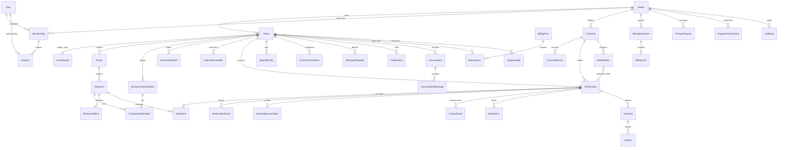

# Modello dati e invarianti

Lo schema completo e i vincoli sono nelle migrazioni `0001`, `0002`, con snapshot congelati indipendenti dai futuri modelli ORM. Tutte le entità hanno UUID e created_at/updated_at. Tutti gli orari persistiti sono timestamptz UTC, il fuso della sede è IANA (Europe/Rome). Nome cliente in chiaro con RLS; recapiti, MFA e destinazioni cifrati Fernet con chiave esterna. Token solo SHA256.

WebhookReceipt e ProviderCostRule sono registri provider globali minimizzati senza PII ospiti. Identità, sessioni e membership globali non sono una base clienti condivisa. La sessione rimanda a una membership autentica; nessun client sceglie tenant arbitrariamente. VenueRoute contiene solo slug/UUID verificati. Tenant_id è SET LOCAL a ogni transazione, non globale mutabile. Operational tables con tenant_id hanno RLS ENABLE/FORCE; tenants ha policy su id. Runtime è NOSUPERUSER/NOBYPASSRLS; identity/routing/plan sono read-only per l'app. Migrazioni e seed usano solo un ruolo privilegiato locale separato e controllato. Produzione: privilege split/identity service da validare.

FK composite tenant+sede per risorse, sale, combinazioni, allocazioni, prenotazioni, policy/connessioni/agenda. FK tenant+customer/reservation/document/payment per dati relativi. UNIQUE su riferimenti pubblici, digest token, chiavi outbox/notification/usage/payment/refund e webhook(provider,account,event). CHECK su capacità/intervalli/importi/tipi messaggio/stati principali. Alcuni campi di contesti successivi (provider subscription reference, quote limits, refund policy) hanno schema ma non lifecycle commerciale completo.

Allocation EXCLUDE GiST con btree_gist: `(tenant_id =, resource_id =, tstzrange(starts_at,ends_at,'[)') &&)` per `active=true`. Una combinazione alloca ogni membro fisico. Lock mutex di sede, poi lock risorse UUID ordinati. Disponibilità legge turni/chiusure/blocchi, durata reale, preavviso/orizzonte, capienze e limite arrivi. RLS protegge anche query prive di WHERE tenant, worker ed export.

Transizioni consentite (vincolate dal dominio, non da input libero): HOLD → pending/awaiting/confirmed/cancelled/expired; PENDING_APPROVAL → awaiting/confirmed/rejected/cancelled/expired; AWAITING_PAYMENT → confirmed/cancelled/expired; CONFIRMED → seated/cancelled/no_show; SEATED → completed; terminali non riaperti. Pending/HOLD/awaiting occupano risorse fino a scadenza transazionale. Gli endpoint controllano versione e lock; la modifica che fallisce rollbacka l'intera transazione.

Importi = centesimi interi; aliquote Numeric(6,3), quantità Numeric(14,4), costi stimati Numeric(14,6). IVA per linea arrotondata HALF_UP al centesimo su imponibile*aliquota/100, poi somma delle linee; non aritmetica float. SaaS default 22%, separato dall'aliquota acconto configurata dal ristorante. Snapshot immutabile su prenotazione e documento. Quote demo non sono fatture, acconti non sono ricavo piattaforma.

Cancellazioni: tutte le FK operative RESTRICT/NO ACTION, nessuna cascata indiscriminata e nessun soft delete generale. Cancellare una prenotazione cambia stato e libera allocation, mantiene evento e termini; una richiesta privacy elimina identificatori e revoca accessi, conservando statistiche anonime. Rimozione effettiva dei record/retention fiscale/backup richiede policy validata; vedere PRIVACY.md. Downgrade distruttivo è rifiutato. `reset-demo` è l'unica ricreazione DB automatica, limitata al database demo fisso.
